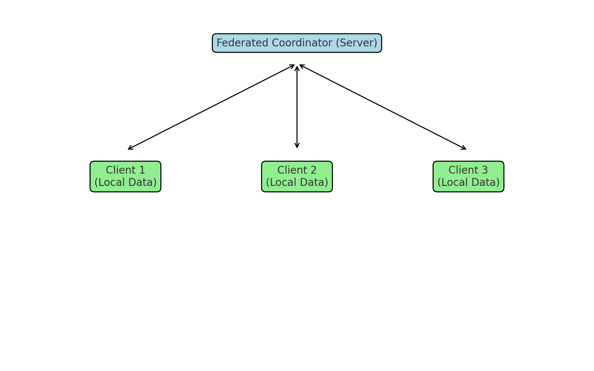

# Federated Fraud Detection

A Python prototype showing how several banks could train a shared fraud-detection model **without pooling their transaction data**. Each bank (a "client") trains on its own records, and only model weights travel to a central coordinator, which averages them into a global model (Federated Averaging).

The project runs on synthetic data, so it is safe to explore, share and extend.



## Why federated learning for fraud

Fraud rings rarely hit just one institution, but banks can't simply share customer transactions with each other. Privacy rules (GDPR, GLBA), data-residency limits and competitive concerns all get in the way. Federated learning gives each participant the benefit of a model trained on everyone's patterns while the raw data never leaves its owner.

## How it works

1. **Load the data**: synthetic card transactions with amount, merchant, location, device, cross-border flag and a fraud label.
2. **Split it across clients**: the dataset is divided between three simulated banks.
3. **Train locally**: each client trains a small Keras neural network on its own slice.
4. **Aggregate**: TensorFlow Federated runs weighted Federated Averaging over 10 rounds, with SGD on the clients and Adam on the server.
5. **Evaluate**: the global model is scored on the combined data.

## Repository layout

```text
fraud-detection-federated/
├── data/        Synthetic transaction datasets (CSV)
├── docs/        Architecture diagram, roadmap, fraud-detection standards notes
├── models/      Output location for trained global models
├── notebooks/   Jupyter notebooks for data exploration and a basic federated run
└── src/         Python source code and tests
```

### Key source files

| File | What it does |
|------|--------------|
| `federated_train.py` | End-to-end federated simulation with TensorFlow Federated |
| `main.py` | Command-line data analysis: summary stats, fraud rate and charts |
| `data_loader.py`, `preprocessing.py` | Loading, encoding, scaling and train/test splits |
| `client_simulator.py` | Splits a dataset into simulated client partitions |
| `model_builder.py`, `trainer.py` | Configurable Keras models and local training with early stopping |
| `evaluator.py` | Accuracy, precision, recall, F1, confusion matrix, ROC and PR curves |
| `model_inference.py` | Loads a saved model and scores new transactions |
| `utils.py` | Metric logging and report export helpers |
| `test_main.py` | Data-integrity unit tests |

## Data

`data/synthetic_data.csv` holds 250 generated transactions with a fraud rate of about 15.6%. The columns are:

`transaction_id`, `amount`, `merchant_id`, `timestamp`, `location`, `device_type`, `user_id`, `is_international`, `is_fraud`

There are also smaller datasets for high-fraud, low-fraud and merchant-pattern scenarios. None of the data is real and it contains no personal information.

## Getting started

Requires Python 3.9 or later.

```bash
git clone https://github.com/RahulAutade2288/fraud-detection-federated.git
cd fraud-detection-federated/fraud-detection-federated/src

pip install pandas numpy matplotlib seaborn scikit-learn tensorflow tensorflow-federated
```

Explore the data:

```bash
python main.py --summary --fraud --charts
```

Charts are saved to `../docs/`.

Run the federated simulation:

```bash
python federated_train.py
```

Run the tests:

```bash
python -m unittest test_main
```

> TensorFlow Federated pins specific TensorFlow versions. If the install conflicts, a fresh virtual environment usually helps.

## Fraud-detection context

`docs/industry_standards.md` summarizes the techniques used in practice (rules, velocity checks, supervised and unsupervised ML) and the compliance points a production system would have to meet, such as PCI DSS, FFIEC guidance and data minimization.

## Roadmap

- Encode categorical features (merchant, location, device) for the federated model
- Handle class imbalance (class weights or resampling) and report precision and recall, not just accuracy
- Non-IID client splits, so each simulated bank sees a different fraud mix
- Secure aggregation and differential privacy
- Streaming, near-real-time scoring

See `docs/project_roadmap.md` for more.

## Disclaimer

This is a learning and research prototype built on synthetic data. It is not a production fraud system.

## Author

**Rahul Autade**, Payments Modernization & Implementation Leader
[rahulautade2288.github.io](https://rahulautade2288.github.io/) · [LinkedIn](https://www.linkedin.com/in/rahul-autade/)
